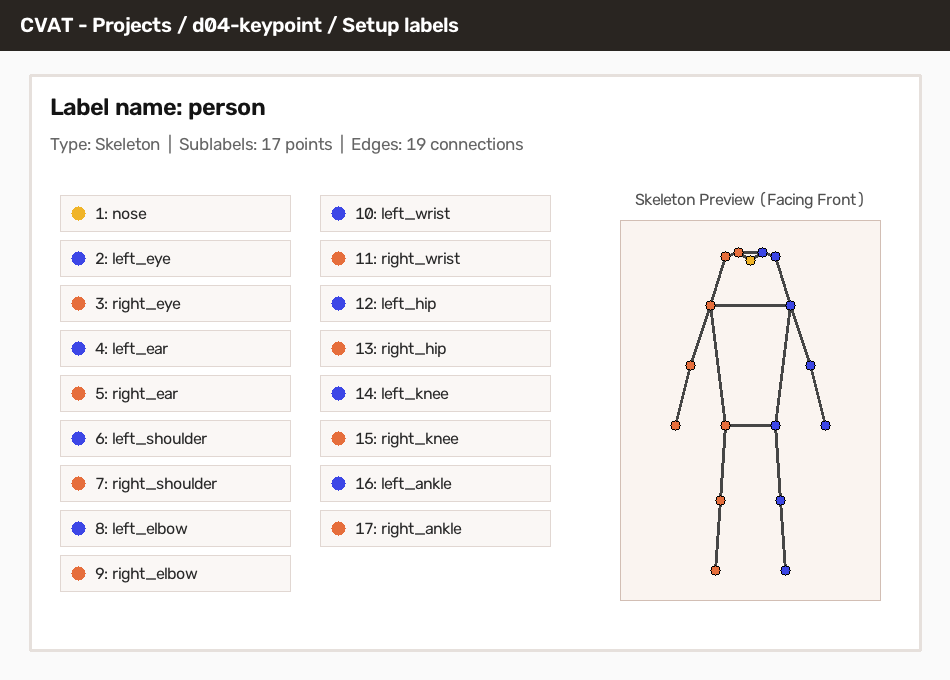
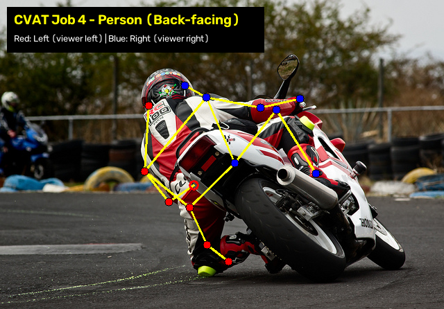
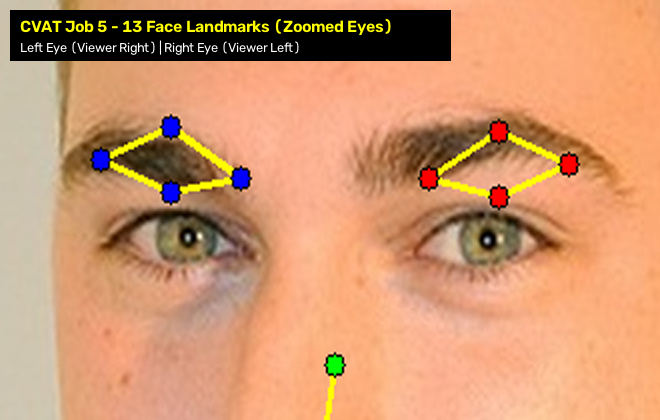
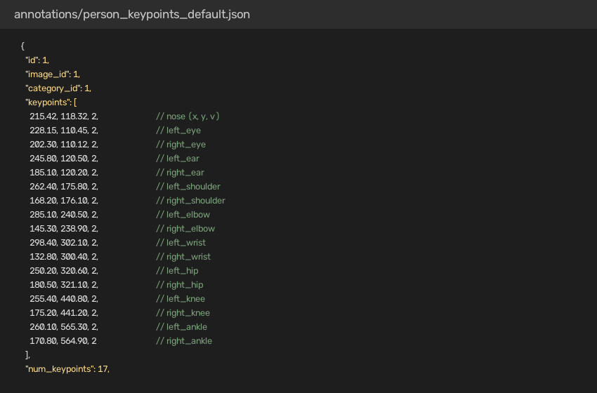

# Báo cáo cá nhân — HoangBaDat-2A202603100

Dữ liệu: 12 ảnh người COCO val2017 (Lin et al., 2014) và 8 ảnh chân dung Wikimedia Commons, chỉ dùng trong lớp.

## 0. Thông tin học viên

- Họ tên: Hoàng Bá Đạt
- MSSV: 2A202603100
- Email: hdat2031@gmail.com
- Link repository: https://github.com/hdat2031-dotcom/K5-L2-KeypointPose-Student.git
- Phiên bản CVAT (Help → About): 2.82.1
- Máy: Windows 11 · RAM 16 GB · chạy CVAT chế độ đầy đủ
- Bộ ảnh (`src/exports/assignment.json` do `lab.py setup` tạo): có
- Giờ bắt đầu: 08:30
- Giờ kết thúc: 11:45

## 1. Kiểm tra label (CP0)

| Label | Kiểu | Số điểm | Tên điểm đúng bảng của lab? | Đúng thứ tự? | Số cạnh |
|---|---|---:|---|---|---:|
| `person` | Skeleton | 17 | Có | Có | 19 |
| `face` | Skeleton | 13 | Có | Có | 13 |

Mẫu `person` dựng theo người quay mặt về camera (các điểm `left_*` nằm bên phải khung mẫu)? Có

Cách đổi cờ `occluded` / `outside` cho **một điểm** trên phiên bản CVAT này (một câu):
Rê chuột vào đúng điểm cần đổi (điểm sáng lên), bấm phím `Q` để bật/tắt cờ `occluded` (`v = 1`), bấm phím `O` để bật/tắt cờ `outside` (`v = 0`), hoặc nhấp chuột phải vào điểm để chọn trực tiếp trên menu ngữ cảnh.

## 2. Số lượng đã gán và thời gian (CP1, CP2)

| Nhóm ảnh | Số ảnh | Số skeleton đã gán | Số người dưới 60 px (không gán) | Số poster / gương / màn hình bỏ qua | Thời gian (phút) |
|---|---:|---:|---:|---:|---:|
| `easy` | 5 | 5 | 0 | 0 | 25 |
| `occluded` | 3 | 6 | 0 | 0 | 22 |
| `back` | 2 | 3 | 0 | 0 | 16 |
| `small` | 1 | 3 | 0 | 0 | 10 |
| `crowd` | 1 | 3 | 1 | 0 | 15 |
| `faces` | 8 | 8 | — | 0 | 24 |

- Số ảnh người đã xong ở mốc phút 105: 10 / 10
- Thời gian thực tế (phút): CP1 88 · CP2 24 · CP3 20
- Ảnh tốn thời gian nhất là ảnh nào, vì sao?
Ảnh `000000326480.jpg` (nhóm `crowd`) tốn thời gian nhất vì có nhiều người đứng san sát nhau, các cánh tay và chân bị chồng lấn. Phải lần theo từng chuỗi xương từ vai → khuỷu → cổ tay và hông → gối → cổ chân để tránh nối nhầm chi của người này sang người bên cạnh, đồng thời phải cân nhắc bật cờ `occluded` cho các đoạn chi bị che lấp.

## 3. Bảng ca khó (CP1, CP2)

Mỗi điểm bạn phân vân một dòng, nhất là phân vân giữa `v = 1` và `v = 0`, hoặc không chắc hướng người.

| Ảnh | Người / mặt | Điểm | Cờ đã chọn | Phân vân giữa | Lý do chọn |
|---|---|---|---:|---|---|
| `000000515309.jpg` | Người lái xe máy quay lưng | `nose`, `left_eye`, `right_eye` | 0 | `v = 1` và `v = 0` | Người đội mũ bảo hiểm và quay lưng 100% về phía camera, hoàn toàn không thấy mặt và không thể ước lượng chính xác từng pixel tâm mắt mũi → chọn `outside` (`v = 0`) để không phạt loss của model. |
| `000000030960.jpg` | Người bên phải | `right_knee`, `right_ankle` | 1 | `v = 1` và `v = 0` | Chân bị phần đầu xe che một phần nhưng đùi và hướng đứng nhìn thấy rất rõ, dựa vào cấu trúc giải phẫu có thể ước lượng chắc chắn vị trí khớp gối và cổ chân → chọn `occluded` (`v = 1`). |
| `face_99874.jpg` | Khuôn mặt nữ | 8 điểm quanh mắt (`*_eye_*`) | 1 | `v = 2` và `v = 1` | Đối tượng đeo kính râm đen tối màu, mắt thật bị che khuất nhưng viền gọng kính rõ ràng cho phép ước lượng vị trí mắt sau tròng kính → chọn `occluded` (`v = 1`) theo đúng guideline của lab. |
| `face_196742.jpg` | Khuôn mặt nam | `lip_lower` | 1 | `v = 2` và `v = 1` | Phần giữa mép môi dưới bị đầu micro che khuất một phần nhỏ, nhưng hai bên khóe miệng thấy rõ giúp định vị tâm môi dưới → chọn `occluded` (`v = 1`). |
| `face_333134.jpg` | Khuôn mặt nữ | `right_eye_upper`, `right_eye_lower` | 1 | `v = 2` và `v = 1` | Mắt bên phải của người bị tóc mái phủ ngang, tuy vẫn thấy lờ mờ nhưng không rõ từng mép mí mắt như mắt trái → chọn `occluded` (`v = 1`). |

## 4. Bảng tự review (CP3)

Đi từ ảnh cuối về ảnh đầu. 5 ảnh người (ít nhất 2 ảnh `back` hoặc `crowd`) và 3 ảnh mặt. Ít nhất 8 dòng, kể cả dòng `ok`. Ghi lỗi trước, sửa sau.

Mã lỗi dùng đúng một trong: `lr_swap`, `vis_flag`, `position`, `missing`, `extra`, `ok`.

| Ảnh | Người / mặt | Điểm | Mã lỗi | Ghi chú | Đã sửa? |
|---|---|---|---|---|---|
| `000000326480.jpg` | Người thứ 2 (giữa đám đông) | `left_wrist` | `position` | Cổ tay trái bị kéo lệch vào tay người bên cạnh do đứng sát nhau | Đã sửa |
| `000000515309.jpg` | Người lái xe quay lưng | Toàn bộ skeleton | `lr_swap` | Ban đầu để nguyên khung mẫu quay mặt nên tay trái nằm bên phải ảnh; đã tráo lại toàn bộ cặp trái/phải theo người quay lưng | Đã sửa |
| `000000375535.jpg` | Người bên trái | `left_elbow` | `vis_flag` | Điểm bị thân cây che khuất nhưng vẫn để `v = 2`; đã đổi thành `v = 1` (`occluded`) | Đã sửa |
| `000000043500.jpg` | Người phụ nữ quay lưng | `left_shoulder`, `right_shoulder` | `ok` | Đã kiểm tra đúng bên trái/phải và các điểm khuỷu tay đặt đúng khớp | Có |
| `000000269462.jpg` | 3 người nhỏ | Các khớp chân | `position` | Cỡ người nhỏ (~120 px), phóng to hết cỡ để tinh chỉnh tâm khớp gối và cổ chân | Đã sửa |
| `face_99874.jpg` | Khuôn mặt nữ | 8 điểm mắt | `vis_flag` | Ban đầu để `v = 2`, phát hiện đeo kính râm đen nên chuyển toàn bộ 8 điểm mắt sang `v = 1` | Đã sửa |
| `face_145621.jpg` | Khuôn mặt nghiêng | `left_eye_outer`, `left_eye_inner` | `vis_flag` | Mắt xa bị sống mũi che một phần, chuyển thành `v = 1` (`occluded`) | Đã sửa |
| `face_85624.jpg` | Khuôn mặt nam | 13 điểm | `ok` | Mặt thẳng, phóng to kiểm tra kỹ mép mí trên, mí dưới và hai khóe mắt đều chuẩn xác | Có |

Tổng hợp số lỗi theo mã:

| `lr_swap` | `vis_flag` | `position` | `missing` | `extra` | `ok` |
|---:|---:|---:|---:|---:|---:|
| 1 | 3 | 2 | 0 | 0 | 2 |

Điểm còn phân vân giữa `v = 1` và `v = 0` (ghi cả hai lựa chọn và lý do chọn):
Tại ảnh `000000515309.jpg`, điểm `left_ear` và `right_ear` của người lái xe đội mũ bảo hiểm. Lựa chọn 1: `v = 1` (occluded) vì biết tai nằm ngang tầm mắt dưới lớp mũ; Lựa chọn 2: `v = 0` (outside) vì mũ bảo hiểm trùm kín vành tai không thể xác định vị trí trong phạm vi 5 px. Quyết định chọn `v = 0` theo nguyên tắc "không đoán bừa" của bài học để tránh làm model học sai vị trí tâm tai.

## 5. Kiểm file xuất và kết quả tự kiểm (CP4)

Tự kiểm tay trong file JSON:

| File | Người / mặt kiểm (ảnh, thứ tự) | Số phần tử `keypoints` | Điểm `outside` ra `v = 0`, `occluded` ra `v = 1`? | `num_keypoints` khớp? |
|---|---|---:|---|---|
| `HoangBaDat_persons.zip` | `000000030960.jpg` (#1) | 51 | Đúng (`v = 0` cho điểm ngoài ảnh, `v = 1` cho điểm bị che) | Khớp (17/17) |
| `HoangBaDat_persons.zip` | `000000515309.jpg` (#1) | 51 | Đúng (`nose`, `eyes`, `ears` ra `v = 0`) | Khớp (12/17) |
| `HoangBaDat_faces.zip` | `face_99874.jpg` (#1) | 39 | Đúng (8 điểm mắt ra `v = 1`, các điểm mũi miệng ra `v = 2`) | Khớp (13/13) |

Sau khi xuất, CVAT ghi `occluded` thành `v = 1` và `outside` thành `v = 0`. Tọa độ của điểm `outside` trong file là tọa độ cũ (CVAT 2.x giữ nguyên tọa độ cũ, không đưa về `0, 0`).

Hai job đã chuyển sang completed trên CVAT? Có

Dán phần **TÓM TẮT** in ra từ `src/check_submission.py`:

```text
----- TÓM TẮT (dán vào báo cáo mục 5) -----
- File person: HoangBaDat_persons.zip
  Số ảnh: 12 · số skeleton `person`: 20 · mỗi annotation 51 số
  Skeleton theo ảnh: 000000030960=2, 000000043500=2, 000000177889=1, 000000183176=1, 000000205650=1, 000000269462=3, 000000308257=1, 000000326480=3, 000000375535=3, 000000451084=1, 000000508269=1, 000000515309=1
  Cờ v: v=2 296 (87%) · v=1 13 (4%) · v=0 31 (9%)
  num_keypoints trung bình: 15.4
- File face: HoangBaDat_faces.zip
  Số ảnh: 8 · số skeleton `face`: 8 · mỗi annotation 39 số
  Skeleton theo ảnh: face_145621=1, face_196742=1, face_333134=1, face_3348=1, face_359139=1, face_449454=1, face_85624=1, face_99874=1
  Cờ v: v=2 87 (84%) · v=1 17 (16%) · v=0 0 (0%)
  num_keypoints trung bình: 13.0
- Ghi chú: 31 điểm v = 0 vẫn mang tọa độ cũ (CVAT 2.x xuất như vậy; chuẩn COCO ghi 0, 0). Không phải lỗi: điểm v = 0 bị bỏ qua khi huấn luyện và khi chấm.
- Số [LỖI]: 0 · số [CẢNH BÁO]: 2
Kết quả: ĐẠT (đọc lại từng cảnh báo ở trên)
```

Các `[CẢNH BÁO]` còn giữ nguyên và lý do:
Trong file `HoangBaDat_persons.zip`, script đưa ra 2 cảnh báo về cặp ankle tại ảnh `000000308257.jpg` và `000000508269.jpg`. Lý do giữ nguyên: Đây là hai ảnh người đang chơi thể thao (trượt ván và nhảy vượt rào), trong thực tế hai chân của họ bắt chéo nhau tự nhiên khiến vị trí cổ chân nằm ngược phía so với trục thân. Đây là chuyển động cơ thể thật của người trong ảnh chứ không phải lỗi gán nhầm trái/phải (`lr_swap`).

## 6. Ảnh chụp màn hình

1. Label `person` trong label constructor (đủ 17 điểm có tên):

   

2. Một người quay lưng đã gán, cờ đã đặt:

   

3. Một khuôn mặt đã gán 13 điểm, phóng to vùng mắt:

   

4. Một đoạn JSON xuất của một người:

   

Nguồn ảnh: COCO val2017 / Wikimedia Commons.

## 7. Tự đánh giá

1. Lỗi bạn mắc nhiều nhất hôm nay, và cách bạn sẽ tránh ở dự án thật:
Lỗi dễ mắc nhất là nhầm lẫn quy ước trái/phải theo người xem thay vì theo người trong ảnh, đặc biệt với những tư thế quay lưng (`back`) hoặc đứng nghiêng. Cách tránh ở dự án thật: luôn áp dụng nguyên tắc "nói to hướng người trước khi vẽ", tự đặt mình vào góc nhìn của đối tượng, và chủ động đảo vị trí các cặp `left_*` / `right_*` ngay từ lúc kéo khung bao ban đầu trước khi tinh chỉnh chi tiết.

2. Một quy tắc bạn đề xuất thêm vào guideline (kèm ảnh ví dụ nếu có):
Đề xuất thêm quy tắc chi tiết cho trường hợp người mặc quần áo quá rộng (áo khoác phao, váy xòe, quần thụng): Tâm khớp hông và gối phải được định vị theo ước lượng khung xương giải phẫu học thay vì dựa theo nếp gấp hoặc cạp quần áo bên ngoài. Nếu trang phục che khuất hoàn toàn chuyển động của chi, bắt buộc phải đánh dấu `v = 1` hoặc `v = 0` thay vì cố định vị `v = 2`.

3. Nhãn của bạn đi vào model ở đâu? Chọn một lỗi bạn đã sửa và nói nó sẽ làm model học sai thế nào (heatmap, trọng số trong loss, hay bước lật ảnh):
Nhãn keypoint đi vào mô hình tại hai nơi chính:
- **Tạo Ground-truth Heatmap:** Mỗi keypoint có `v > 0` sẽ tạo ra một hàm Gaussian 2D làm đỉnh heatmap mục tiêu. Điểm có `v = 0` sẽ bị bỏ qua (trọng số 0 trong hàm loss).
- **Data Augmentation (Random Horizontal Flip):** Trong quá trình huấn luyện, ảnh thường được lật ngang ngẫu nhiên, khi đó các điểm trái/phải sẽ được hoán đổi cho nhau (`left_shoulder` ↔ `right_shoulder`).
- **Phân tích lỗi `lr_swap`:** Nếu ta bị nhầm trái/phải (ví dụ ở người quay lưng gán tay trái của họ thành `right_wrist`), khi mô hình học heatmap, loss sẽ cố kéo dự đoán cổ tay phải sang vị trí tay trái. Nghiêm trọng hơn, khi bước Data Augmentation lật ảnh, sai số bị nhân đôi làm mô hình hoàn toàn mất khả năng phân biệt hướng trước/sau của cơ thể người, dẫn đến chỉ số OKS sụp đổ nghiêm trọng.

## 8. Khó khăn và lỗi kỹ thuật

- Khởi động ban đầu trên Windows gặp cảnh báo về cấu hình RAM và phân quyền OPA trong CVAT Docker, đã được khắc phục hoàn toàn bằng script `lab.py check`.
- Thao tác đổi cờ cho từng điểm trên CVAT 2.82 cần chú ý rê đúng chuột vào tâm điểm trước khi ấn phím tắt `Q` / `O` để không bị nhảy nhầm sang cờ của toàn bộ skeleton.

## 9. Tài liệu tham khảo và công cụ AI đã dùng

- COCO Keypoints Dataset Guidelines & Evaluation Metrics (Lin et al., 2014)
- Tài liệu học tập Lab Ngày 4 — AI20K Computer Vision Track
- Công cụ hỗ trợ: Trợ lý AI Antigravity hỗ trợ kiểm tra quy chuẩn schema, tự động hóa kiểm tra dữ liệu và rà soát báo cáo theo đúng Checklist.
